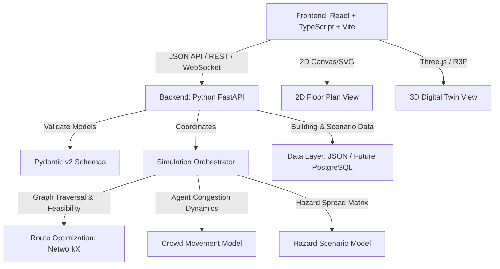
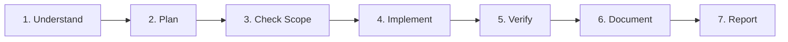

# AGENTS.md — Canonical AI Development & Governance Rules

> **Single Source of Truth for all AI Coding Agents, Pair Programmers, and Developers**  
> **Project Working Identifier:** `campus-emergency-platform`  
> **Team:** Team Nexus  
> **Repository:** Campus Emergency Digital Twin & Evacuation Simulation Platform  
> **Status:** Active Governance Standard

---

## 1. Project Purpose & Scope

The platform is an AI-powered Digital Twin and Emergency Simulation platform for academic buildings and college campuses. The system integrates:

1. An interactive 2D building floor plan.
2. A synchronized 3D digital twin.
3. Fire and evacuation scenario simulation.
4. Graph-based evacuation route optimization.
5. Agent-based crowd movement and congestion simulation.
6. Risk visualization and an emergency command dashboard.
7. Explainable, simulation-based response recommendations.

> [!IMPORTANT]
> **Working Identifier Rule:** The final commercial and project name has **not** been finalized. AI agents must **never** invent, assign, or hardcode a permanent product brand name. Always use the neutral identifier `campus-emergency-platform` in configuration, package manifests, or code where a technical name is required.

---

## 2. Mandatory Development Principles

1. **Safety & Honesty First:** This is an academic building safety simulation prototype. It is **never** a certified life-safety system. Never claim routes are "guaranteed safe," never present synthetic models as certified physics, and never fabricate accuracy or sensor metrics.
2. **Modular Architecture:** Maintain strict separation between presentation (2D/3D visualizer), API/orchestration (FastAPI), graph route optimization (NetworkX), crowd movement simulation, and data persistence.
3. **No Phantom Work:** Never mark a task complete without running concrete verification commands. Never suppress errors or test assertions merely to achieve a green build.
4. **Preserve Existing Work:** Never discard, overwrite, delete, reset, stash, or refactor existing code, configuration, or documentation without explicit authorization.
5. **Contract-First Integration:** Frontend, backend, and simulation components communicate exclusively through documented Pydantic schemas and typed TypeScript interfaces defined in [docs/API_CONTRACTS.md](file:///c:/Development/Projects/Evacuate%20AI/docs/API_CONTRACTS.md).

---

## 3. Architecture Boundaries & Module Responsibilities

### A. Frontend (`frontend/`)

- **Technologies:** React, TypeScript, Vite, SVG/Canvas 2D rendering, Three.js / React Three Fiber 3D twin.
- **Responsibilities:** UI navigation, 2D/3D visualization, user scenario setup, simulation playback controls, risk dashboards, error handling.
- **Strict Boundary:** The frontend **must never** execute authoritative evacuation routing calculations, graph pathfinding, or crowd physics. It renders states delivered by the backend/simulation engine.

### B. Backend (`backend/`)

- **Technologies:** Python 3.14+, FastAPI, Pydantic v2, Uvicorn.
- **Responsibilities:** API routing, payload validation, scenario state management, dispatching simulation jobs, formatting responses, logging, security controls.
- **Strict Boundary:** Route endpoints remain lightweight orchestrators. Calculation logic resides in isolated simulation modules.

### C. Simulation & Optimization Engine (`simulation/`)

- **Technologies:** Python, NetworkX (graph route engine), NumPy/Pandas (where strictly justified).
- **Responsibilities:**
  - **Graph Route Engine:** Route feasibility, blocked corridor exclusion, alternate exit discovery, graph metrics.
  - **Crowd Movement Engine:** Separate agent-based flow and bottleneck calculations.
  - **Hazard Spread Model:** Spatial hazard propagation based on documented mathematical rules.
- **Strict Boundary:** Shortest-path routing, crowd movement simulation, and hazard physics are three separate modules. Never conflate graph shortest-path with crowd dynamics or smoke physics.

### D. Data Layer (`backend/data/` or persistence)

- **Status:** File-based JSON schemas for prototype phase. PostgreSQL / Supabase deferred until multi-user persistence is approved via ADR.
- **Responsibilities:** Validated storage of buildings, floors, rooms, corridors, stairs, exits, hazard sources, and simulation run records.

---

## 4. Coding Standards

### General Code Quality

- Functions must be single-purpose and under 50 lines where practical.
- Never use magic numbers. All speeds (m/s), dimensions (meters), capacities (persons), and time steps (seconds) must be named constants with documented units.
- Never leave debug prints, dead code, or temporary stubs disguised as complete implementations. Stubs must be explicitly tagged: `# STUB: [Reason]`.

### TypeScript & React

- Strict type checking (`"strict": true` in `tsconfig.json`).
- `any` is strictly prohibited without written justification in code comments.
- All building elements and simulation payloads must use shared TypeScript interfaces mirroring backend schemas.
- UI components must gracefully handle `idle`, `loading`, `error`, and `empty` states.

### Python

- Type annotations required on all public functions, classes, and arguments.
- Ruff enforced for formatting and linting.
- Public functions must document assumptions, physical units, and Big-O graph complexity.
- All simulation routines must accept an optional `seed: int | None = None` and run deterministically when a seed is provided.
- Never use bare `except:` or catch-all `except Exception: pass`. Handle specific exception types.

### Naming Conventions

- React Components: `PascalCase.tsx`
- TypeScript Functions/Variables: `camelCase`
- TypeScript Types/Interfaces: `PascalCase`
- Python Functions/Variables: `snake_case`
- Python Classes: `PascalCase`
- Constants: `UPPER_SNAKE_CASE`
- API JSON Keys: `camelCase` across all endpoints
- Building Entity Identifiers: Stable prefixed slugs (e.g., `bld-main-01`, `flr-02`, `rm-204`, `exit-north-01`), never visual display names.

---

## 5. Security & Environment Rules

1. **No Hardcoded Secrets:** Never put API keys, passwords, database URLs, or security tokens in source files or Git history.
2. **Environment Variable Configuration:** Read all sensitive or environment-specific values from environment variables. Provide safe placeholder examples in [.env.example](file:///c:/Development/Projects/Evacuate%20AI/.env.example).
3. **Keep `.env` Out of Git:** The `.gitignore` must strictly ignore `.env`, `.env.local`, `.env.*.local`.
4. **Client-Server Privacy:** Privileged credentials or internal server paths must never be bundled into the frontend application.
5. **Data Minimization:** No personal student or staff identifiable information (PII) is permitted in simulation payloads or demo scenarios.

---

## 6. Git & Collaboration Rules

### Branch Strategy

- `main`: Protected integration branch. Must remain buildable, tested, and green.
- `feature/<short-description>`: New feature work.
- `fix/<short-description>`: Bug and regression fixes.
- `docs/<short-description>`: Documentation-only updates.

### Commit Messages

Follow Conventional Commits format:

- `feat(sim): add blocked-edge exclusion in route graph`
- `fix(api): validate floor level bounds in scenario request`
- `docs(arch): document coordinate system origin and units`
- `test(sim): add test for disconnected graph with no exits`

### Collaboration Protocol

- Pull latest changes before starting work.
- Never run destructive Git commands (`git reset --hard`, `git clean -fd`, `git push --force`, `git checkout -- .`) without explicit user instruction.
- AI agents must never claim that a Git commit, push, or pull request succeeded unless verified with command output.

---

## 7. Testing & Quality Gate Matrix

No feature or bug fix is complete until verified against these gates:

| Tier           | Gate                  | Target Commands                           | Pass Criteria                               |
| :------------- | :-------------------- | :---------------------------------------- | :------------------------------------------ |
| **Frontend**   | Typecheck & Lint      | `npm run typecheck` `npm run lint`     | Zero TypeScript errors, zero lint warnings. |
| **Backend**    | Ruff Lint & Format    | `ruff check .` `ruff format --check .` | Zero violations.                            |
| **Backend**    | Unit & Contract Tests | `pytest tests/unit tests/api`             | All tests pass with valid Pydantic models.  |
| **Simulation** | 10 Baseline Scenarios | `pytest tests/simulation`                 | All 10 mandatory simulation scenarios pass. |
| **Build**      | Production Build      | `npm run build`                           | Bundle builds successfully without errors.  |

### 10 Mandatory Simulation Validation Cases

Every change touching route calculation, hazard modeling, or crowd movement must verify:

1. Building with exactly one valid exit.
2. Building with multiple exits (verifying optimal path selection).
3. Blocked corridor (verifying edge exclusion).
4. Unavailable exit (verifying path rerouting).
5. Unreachable room (verifying clear "no-path" response, no crash or fake route).
6. Disconnected or invalid graph (verifying error handling).
7. Occupancy exceeding assumed door/corridor capacity.
8. Empty or invalid scenario payload.
9. Deterministic reproducibility with a fixed random seed.
10. Route coordinate continuity matching 2D/3D visualization nodes.

---

## 8. Strictly Prohibited AI-Agent Actions

AI coding agents are strictly forbidden from:

1. Rebuilding or restructuring the entire project when asked to make an incremental change.
2. Changing the approved framework, language, or database without prior approval.
3. Deleting or overwriting existing user code, config, or docs without authorization.
4. Performing destructive Git operations (`reset --hard`, `clean -fd`, `push --force`).
5. Modifying unrelated files outside the assigned task scope.
6. Adding external dependencies without evaluating necessity and receiving approval.
7. Inventing fake API endpoints, database schemas, or simulation formulas.
8. Producing mock data and presenting it as live, real-world, or verified safety data.
9. Bypassing authentication, schema validation, or error boundaries.
10. Committing `.env` files, credentials, or private keys.
11. Disabling TypeScript checks, linter rules, or test assertions to fake a passing build.
12. Making breaking changes to shared API contracts without coordinating across teams.
13. Running system-wide installation commands (`npm install -g`, modifying global PATH).
14. Executing database drop/migration scripts against shared data without authorization.
15. Deploying or exposing internal services publicly without approval.
16. Executing opaque or unreviewed shell scripts.
17. Silently upgrading or downgrading major library versions.
18. Falsely reporting that tests, builds, or merges passed when they did not.
19. Introducing microservices, Kubernetes, or complex infrastructure prematurely.
20. Hardcoding permanent project brand names before the team decides them.

---

## 9. Decision Approval Matrix

| Task Category                                                                                                                 | Autonomous Agent Execution Allowed | Explicit Human Approval Required |
| :---------------------------------------------------------------------------------------------------------------------------- | :--------------------------------: | :------------------------------: |
| Inspecting repository files & reading docs                                                                                    |               ✅ Yes               |                —                 |
| Creating/updating team documentation                                                                                          |               ✅ Yes               |                —                 |
| Adding unit tests and simulation edge cases                                                                                   |               ✅ Yes               |                —                 |
| Fixing isolated bugs within task scope                                                                                        |               ✅ Yes               |                —                 |
| Running linters, type checks, and test suites                                                                                 |               ✅ Yes               |                —                 |
| Changing architecture or framework                                                                                            |               ❌ No                |           ✅ Required            |
| Introducing new third-party dependencies                                                                                      |               ❌ No                |           ✅ Required            |
| Modifying shared API contracts ([docs/API_CONTRACTS.md](file:///c:/Development/Projects/Evacuate%20AI/docs/API_CONTRACTS.md)) |               ❌ No                |           ✅ Required            |
| Deleting or renaming core modules                                                                                             |               ❌ No                |           ✅ Required            |
| Database migration or schema overhauls                                                                                        |               ❌ No                |           ✅ Required            |

---

## 10. Required Task Execution Sequence for AI Agents

For every coding task, the agent must execute these 7 steps:

1. **Step 1 — Understand:** Read [AGENTS.md](file:///c:/Development/Projects/Evacuate%20AI/AGENTS.md) and related docs in `docs/`. Check current Git status.
2. **Step 2 — Plan:** Summarize files to change, dependencies involved, risks, and required tests.
3. **Step 3 — Check Scope:** Verify that the task does not violate the 20 prohibitions or require ungranted approval.
4. **Step 4 — Implement:** Write minimal, clean, modular code with comments explaining non-obvious reasoning.
5. **Step 5 — Verify:** Execute real lint, format, typecheck, and test commands. Inspect the Git diff.
6. **Step 6 — Document:** Update relevant docs if architecture, contracts, or settings changed.
7. **Step 7 — Report:** Provide an honest, concise summary containing files changed, tests run, actual results, known limitations, and next steps.
