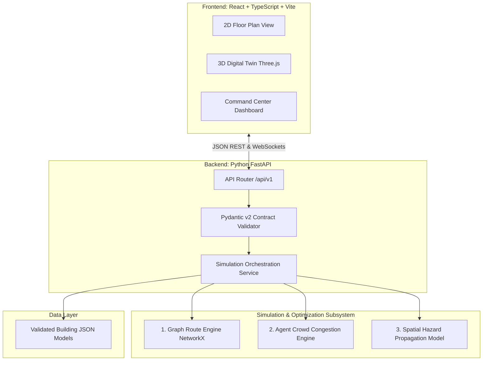

# Campus Emergency Platform

> **AI-Powered Digital Twin & Evacuation Simulation Platform for Academic Campuses**  
> **Working Identifier:** `campus-emergency-platform`  
> **Developed by:** Team Nexus  
> **Status:** Milestone 1 Complete — Development Governance & Environment Foundation

---

## 1. Executive Summary

The **Campus Emergency Platform** is an AI-powered simulation, risk visualization, and spatial command platform designed for academic buildings and university campuses. It bridges the gap between static fire safety floor plans and real-time situational awareness by combining:

- **Interactive 2D Floor Plans:** Canvas/SVG vector layouts displaying rooms, corridors, stairwells, and live occupancy distributions.
- **Synchronized 3D Digital Twin:** Spatial multi-level building visualizations providing spatial context during emergency management.
- **Hazard Scenario Modeling:** Simulation of fire and smoke dispersal with dynamic time-to-blockage calculations.
- **Graph-Based Route Optimization:** NetworkX-driven egress pathfinding using Dijkstra/A* with dynamic edge penalties for obstructed corridors.
- **Agent-Based Crowd Congestion:** Density-dependent movement dynamics and bottleneck identification at exit doors and stairwells.
- **Explainable Command Dashboard:** Transparent evacuation metrics, clearance times, and actionable recommendations.

> [!IMPORTANT]
> **Project Naming Notice:** The permanent commercial and public brand name for this platform has **not** been finalized by Team Nexus. All technical configuration, documentation, package manifests, and development branches use the neutral working identifier `campus-emergency-platform`.

---

## 2. Architecture & Subsystem Boundaries

The system follows a **Modular Monolith** architecture with strict interface boundaries:



---

## 3. Single Source of Truth & Governance Documentation

Every developer, teammate, and AI coding agent must review and adhere to the project governance documentation:

| Document                                                                                                 | Purpose & Contents                                                                                                    |
| :------------------------------------------------------------------------------------------------------- | :-------------------------------------------------------------------------------------------------------------------- |
| **[AGENTS.md](file:///c:/Development/Projects/Evacuate%20AI/AGENTS.md)**                                 | **Canonical AI instruction file.** Contains mandatory coding rules, 20 strict prohibitions, and 7-step task sequence. |
| **[docs/DEVELOPMENT_RULES.md](file:///c:/Development/Projects/Evacuate%20AI/docs/DEVELOPMENT_RULES.md)** | Complete team development constitution, coding standards, and security protocols.                                     |
| **[docs/ARCHITECTURE.md](file:///c:/Development/Projects/Evacuate%20AI/docs/ARCHITECTURE.md)**           | Subsystem boundaries, module responsibilities, and proposed monorepo layout.                                          |
| **[docs/API_CONTRACTS.md](file:///c:/Development/Projects/Evacuate%20AI/docs/API_CONTRACTS.md)**         | Shared data schemas, coordinate reference systems, standard error envelope, and endpoint drafts.                      |
| **[docs/CONTRIBUTING.md](file:///c:/Development/Projects/Evacuate%20AI/docs/CONTRIBUTING.md)**           | Developer onboarding guide, local environment setup, and Git branching policies.                                      |
| **[docs/DECISIONS.md](file:///c:/Development/Projects/Evacuate%20AI/docs/DECISIONS.md)**                 | Architecture Decision Log (ADR 0001 through ADR 0005) and decision proposal template.                                 |
| **[docs/TESTING.md](file:///c:/Development/Projects/Evacuate%20AI/docs/TESTING.md)**                     | Quality verification gates and the 10 mandatory simulation validation scenarios.                                      |

---

## 4. Local Quickstart

### Prerequisites

- **Node.js:** `v20.20.2+`
- **Python:** `3.14.3+`
- **Git:** `2.40+`

### 1. Environment Setup

```bash
# Clone the repository
git clone <repo-url>
cd campus-emergency-platform

# Copy the safe environment variable template
cp .env.example .env
```

### 2. Python Environment & Dependencies

```bash
# Initialize virtual environment
python -m venv .venv

# Activate virtual environment
# Windows PowerShell:
.venv\Scripts\Activate.ps1
# Linux / macOS:
source .venv/bin/activate

# Install Python dependencies
pip install -e ".[dev]"
```

### 3. Node.js Frontend Dependencies

```bash
npm install
```

### 4. Running Quality Verification Checks

```bash
# Run format checking
npm run format:check

# Run Python static checks
ruff check .
ruff format --check .

# Run test suites
pytest tests/unit
pytest tests/simulation
```

---

## 5. Responsible Simulation & Safety Disclaimer

> [!CAUTION]
> **ACADEMIC SIMULATION NOTICE:** This software is an engineering simulation prototype. It is **not** a certified life-safety system, building code compliance tool, or automated emergency dispatch system. Evacuation times and route recommendations are simulated mathematical approximations based on synthetic building models. Under no circumstances should this software override physical fire alarms, certified emergency action plans, or directions from trained first responders.
