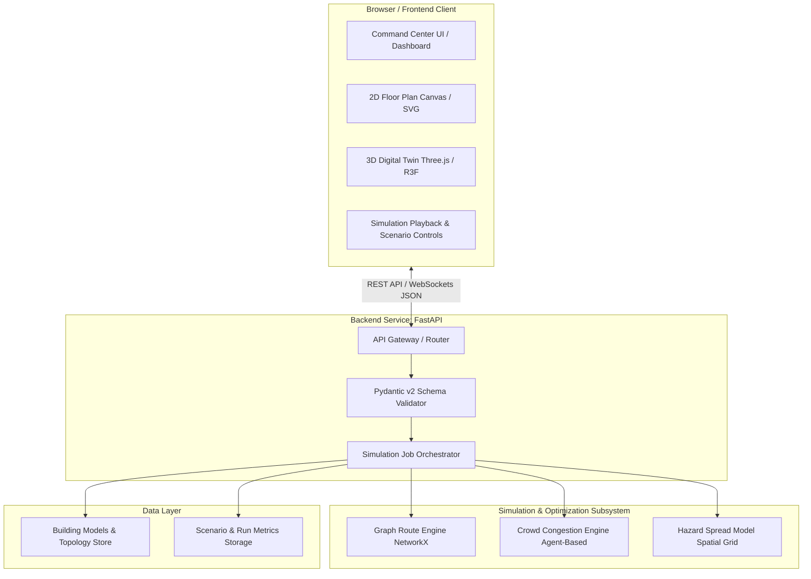
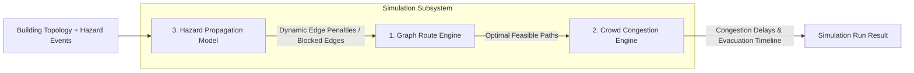

# System Architecture Specification

**Project Working Identifier:** `campus-emergency-platform`  
**Document:** `docs/ARCHITECTURE.md`  
**Status:** PROPOSED (Subject to Team Nexus Review)  
**Revision:** 1.0 (Governance Foundation)

---

## 1. System Overview

The Campus Emergency Platform is a synchronized 2D/3D digital twin and emergency evacuation simulation system designed for academic buildings and university campuses.

The architecture balances:

- High-fidelity spatial visualization in the browser.
- Mathematically sound, graph-based evacuation route optimization.
- Explainable agent-based crowd congestion modeling.
- Clear separation of concerns between presentation, orchestration, simulation, and data persistence.



---

## 2. Component Boundaries & Responsibilities

### 2.1 Frontend Subsystem (`frontend/`)

- **Framework:** React 18/19 with TypeScript in strict mode, bundled via Vite.
- **Styling:** Vanilla CSS with a centralized design token system (avoiding unapproved external utility frameworks unless explicitly agreed upon).
- **2D Floor Plan Engine:** Interactive SVG / Canvas rendering supporting pan/zoom, room highlighting, hazard heatmaps, and dynamic path lines.
- **3D Digital Twin Engine:** Three.js (via React Three Fiber and Drei) rendering multi-level building geometry, floor slice clipping, staircases, and camera viewpoints.
- **State & Synchronization:** A synchronized playback clock keeps the 2D floor plan, 3D digital twin, and time-series telemetry charts strictly aligned at each simulation second ($t$).
- **Strict Boundary:** The frontend is strictly a visualization and user input layer. Under no circumstances may pathfinding algorithms or physical crowd models be computed on the client.

### 2.2 Backend & API Subsystem (`backend/`)

- **Framework:** Python 3.14+ with FastAPI and Uvicorn.
- **Data Validation:** Pydantic v2 with strict type coercion and clear validation error structures.
- **Responsibilities:**
  - Exposing RESTful endpoints for building topology, scenario definition, and simulation execution.
  - Streaming simulation playback steps via WebSocket or chunked responses when handling large agent counts.
  - Enforcing coordinate system consistency and bounds checking before dispatching jobs to the simulation engine.
  - Logging all calculation parameters for reproducibility and audit.

### 2.3 Simulation & Optimization Subsystem (`simulation/`)

The simulation subsystem consists of three distinct, loosely coupled engines:



1. **Graph Route Engine (NetworkX):**
   - Models the building as a directed graph $G = (V, E)$, where $V$ represents rooms, corridor waypoints, stairwell landings, and exits; $E$ represents traversable doorways, corridors, and stairs.
   - Computes shortest and alternative egress paths using Dijkstra / A* with dynamic hazard cost weighting.
   - Strictly removes blocked edges when smoke, fire, or debris obstruct corridors.
   - Generates an explicit "Unreachable" status when no feasible egress route exists for a room.

2. **Crowd Congestion Engine (Agent-Based):**
   - Simulates discrete evacuees or density-based occupant clusters.
   - Calculates speed reduction as a function of local corridor density (Weidmann / Fruin level-of-service curves).
   - Identifies bottlenecks at doorways and stairwell entry points.

3. **Hazard Propagation Model:**
   - Evaluates hazard spread over discrete time steps across building zones.
   - Computes time-to-blockage for corridors and exit doors.

> [!CRITICAL]
> **Separation Principle:** Shortest-path routing, crowd movement simulation, and hazard physics are three separate modules. Shortest-path calculations must never be conflated with crowd movement dynamics or certified fire engineering.

### 2.4 Data Layer Subsystem (`backend/data/` or DB)

- **Phase 1 (Prototype):** File-based, schema-validated JSON building models stored in `backend/data/buildings/`. This eliminates heavy database dependencies during early development.
- **Phase 2 (Proposed):** PostgreSQL with PostGIS extension (or Supabase PostgreSQL).
- **Trigger Criteria for Database Adoption:**
  - Need for user authentication and multi-tenant scenario management.
  - Storage of historical simulation runs exceeding 1,000 runs.
  - Real-time IoT sensor telemetry ingestion.

---

## 3. Directory Layout (Proposed Monorepo Structure)

```
campus-emergency-platform/
├── AGENTS.md                  # Canonical AI governance and developer instructions
├── README.md                  # Project overview and quickstart
├── pyproject.toml             # Python tooling (Ruff, pytest, mypy)
├── package.json               # Root workspace scripts and tooling
├── .env.example               # Safe environment variable configuration template
├── docs/                      # Architectural and governance specifications
│   ├── ARCHITECTURE.md
│   ├── DEVELOPMENT_RULES.md
│   ├── API_CONTRACTS.md
│   ├── CONTRIBUTING.md
│   ├── DECISIONS.md
│   └── TESTING.md
├── frontend/                  # React + TypeScript + Vite frontend
│   ├── src/
│   │   ├── components/        # 2D, 3D, and dashboard UI components
│   │   ├── services/          # API client and WebSocket handlers
│   │   ├── types/             # Shared TypeScript entity contracts
│   │   └── utils/             # Coordinate transformations and formatters
│   └── package.json
├── backend/                   # Python FastAPI service
│   ├── app/
│   │   ├── api/               # Route endpoints (/api/v1/...)
│   │   ├── schemas/           # Pydantic v2 data models
│   │   ├── services/          # Business logic and simulation orchestration
│   │   └── core/              # Config, security, logging
│   └── data/                  # Sample building JSON models
├── simulation/                # Decoupled simulation & optimization engines
│   ├── routing/               # NetworkX graph construction and pathfinding
│   ├── crowd/                 # Agent-based movement and congestion models
│   └── hazard/                # Spatial hazard propagation models
└── tests/                     # Automated test suites
    ├── unit/                  # Fast isolated component and schema tests
    ├── api/                   # FastAPI test client integration tests
    └── simulation/            # 10 mandatory scenario validation tests
```

---

## 4. Architectural Principles

1. **Modular Monolith First:** Keep all modules in a single repository with clear internal boundaries to allow rapid iteration on shared data contracts without the overhead of microservices.
2. **Contract-Driven Communication:** All data passing between frontend, backend, and simulation must validate against the schemas documented in [docs/API_CONTRACTS.md](file:///c:/Development/Projects/Evacuate%20AI/docs/API_CONTRACTS.md).
3. **Reproducibility:** Every simulation run receives a deterministic random seed (`seed: int`), enabling exact replay of agent movement.
4. **Resilient Degradation:** If the 3D digital twin fails to render (e.g., WebGL unavailable), the 2D floor plan and dashboard must continue to operate smoothly.
