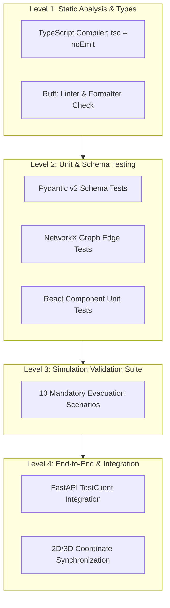

# Testing Strategy & Quality Verification Guide

**Project Working Identifier:** `campus-emergency-platform`  
**Document:** `docs/TESTING.md`  
**Revision:** 1.0 (Governance Foundation)  
**Team:** Team Nexus

---

## 1. Testing Philosophy & Non-Negotiable Rules

1. **No Faked Passing Tests:** Never assert `True == True` or mock away the core algorithm to make a failing test pass.
2. **Deterministic Reproducibility:** Every simulation test case must use a fixed integer random seed (e.g. `seed=42`). Tests must pass consistently across machines without flaky non-deterministic failures.
3. **Physical Graph Validity:** When a corridor is blocked or an exit is shut down, the pathfinder must mathematically exclude those edges. The engine must explicitly return `isReachable: false` rather than quietly directing occupants through a hazard or inventing an unreachable exit.
4. **Honest Reporting:** If a test suite was not run or an environment was unavailable, developers and AI agents must explicitly report the check as **UNVERIFIED**. Never claim an unexecuted check succeeded.

---

## 2. Testing Levels & Target Commands



### 2.1 Static Analysis & Quality Gates

```bash
# Frontend type check
npm run typecheck

# Frontend linting
npm run lint

# Python formatting check
ruff format --check .

# Python lint check
ruff check .
```

### 2.2 Unit & API Integration Testing

```bash
# Python backend unit tests
pytest tests/unit

# Python API endpoint tests
pytest tests/api
```

---

## 3. The 10 Mandatory Simulation Validation Cases

The simulation engine (`simulation/routing/`) cannot be approved without passing all 10 baseline test cases in `tests/simulation/test_evacuation_scenarios.py`:

| Test Case | Scenario Description             | Expected Mathematical Behavior                                                                                                                                                                                         |
| :-------: | :------------------------------- | :--------------------------------------------------------------------------------------------------------------------------------------------------------------------------------------------------------------------- |
|  **01**   | **Single Valid Exit**            | Building with exactly 1 floor and 1 exit. All rooms find paths terminating at this exit. Total evacuated = total initial occupants.                                                                                    |
|  **02**   | **Multiple Possible Exits**      | Building with North and South exits. Occupants in East wing route to North exit; occupants in West wing route to South exit (minimizing path distance/travel time).                                                    |
|  **03**   | **Blocked Corridor**             | A corridor edge $(u, v)$ is flagged as impassable due to fire. The routing graph must prune edge $(u, v)$; alternative paths are chosen without error.                                                                 |
|  **04**   | **Unavailable Exit**             | The primary exit is locked or compromised. Egress reroutes to secondary emergency exit.                                                                                                                                |
|  **05**   | **Unreachable Room**             | A room is completely isolated by fire on all adjoining doors. Route engine must return `isReachable: false`, `assignedExitId: null`, and record `trappedOccupants > 0`. It must **never** route through fire or crash. |
|  **06**   | **Disconnected / Invalid Graph** | Topology input has disjoint islands or cyclic dead-ends. System validates graph connectivity and logs warning; unreachable nodes handled safely.                                                                       |
|  **07**   | **Exceeded Capacity**            | Corridor capacity set to 20 persons; 100 occupants enter. Flow algorithm applies density delay factor (congestion queue). Time increases monotonically.                                                                |
|  **08**   | **Empty or Invalid Payload**     | Empty building model or negative occupancy submitted. Backend returns HTTP 422 with structured validation error envelope.                                                                                              |
|  **09**   | **Deterministic Seed Replay**    | Simulation executed twice with `seed=42`. Agent step positions, bottleneck metrics, and final evacuation times must match byte-for-byte.                                                                               |
|  **10**   | **2D/3D Node Consistency**       | Route waypoints $[x, y, z]$ returned by the engine match the geometric vertices of corridors and doors in both 2D SVG and 3D digital twin.                                                                             |

---

## 4. Acceptance Criteria Checklist for PRs

Before merging any feature or simulation modification, verify:

- [ ] Static typecheck passed with zero errors (`tsc --noEmit`).
- [ ] Ruff lint and format passed with zero warnings.
- [ ] All 10 simulation scenario tests passed (`pytest tests/simulation`).
- [ ] No hardcoded coordinates, speeds, or magic numbers.
- [ ] Errors return standardized envelope (`error`, `code`, `message`, `timestamp`).
- [ ] Results and limitation assumptions documented in commit/PR.
